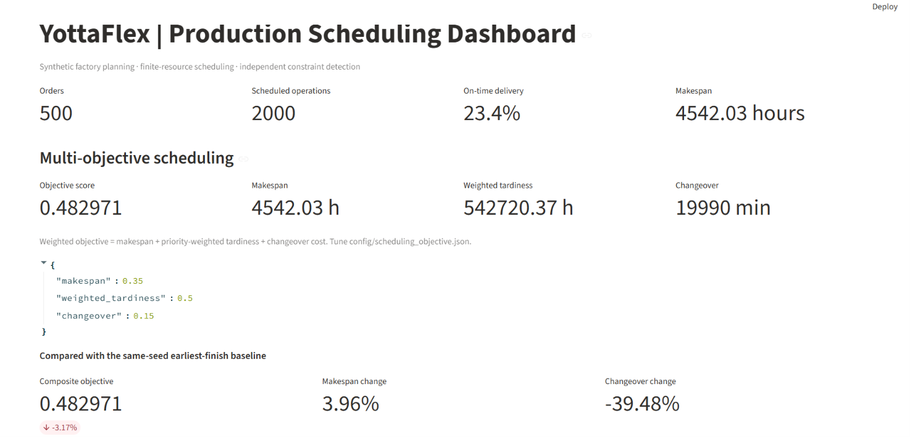
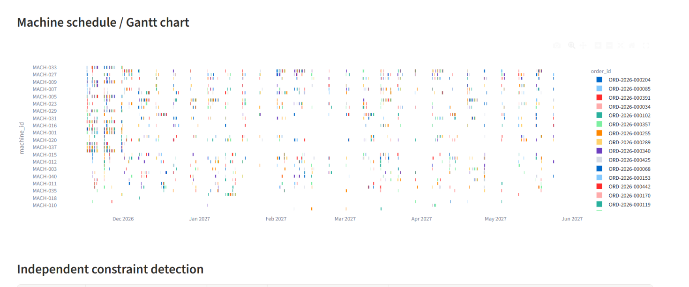
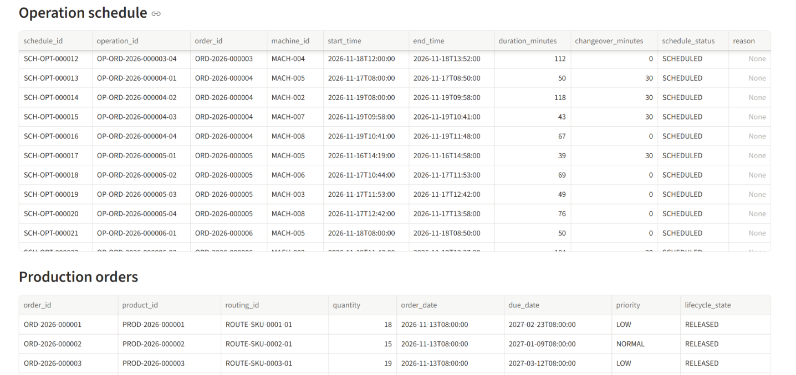
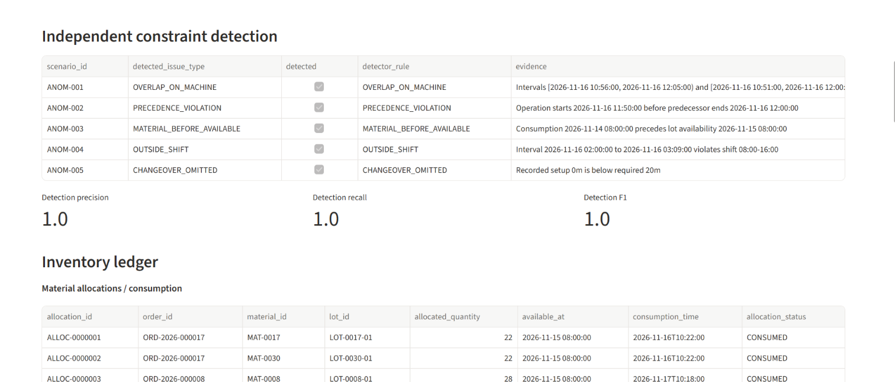
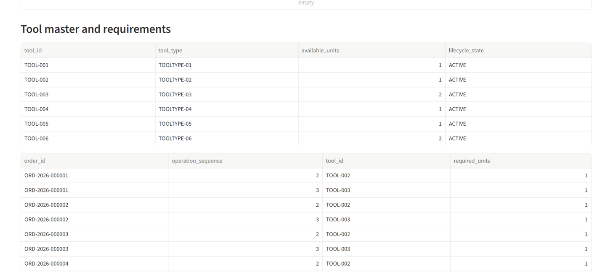
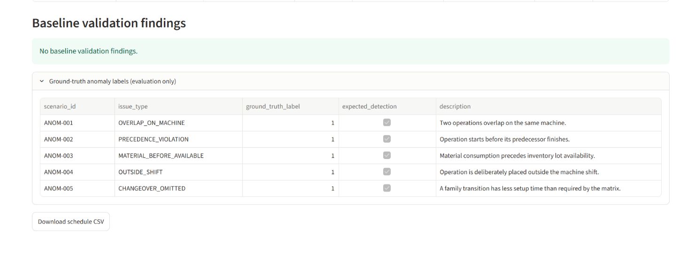
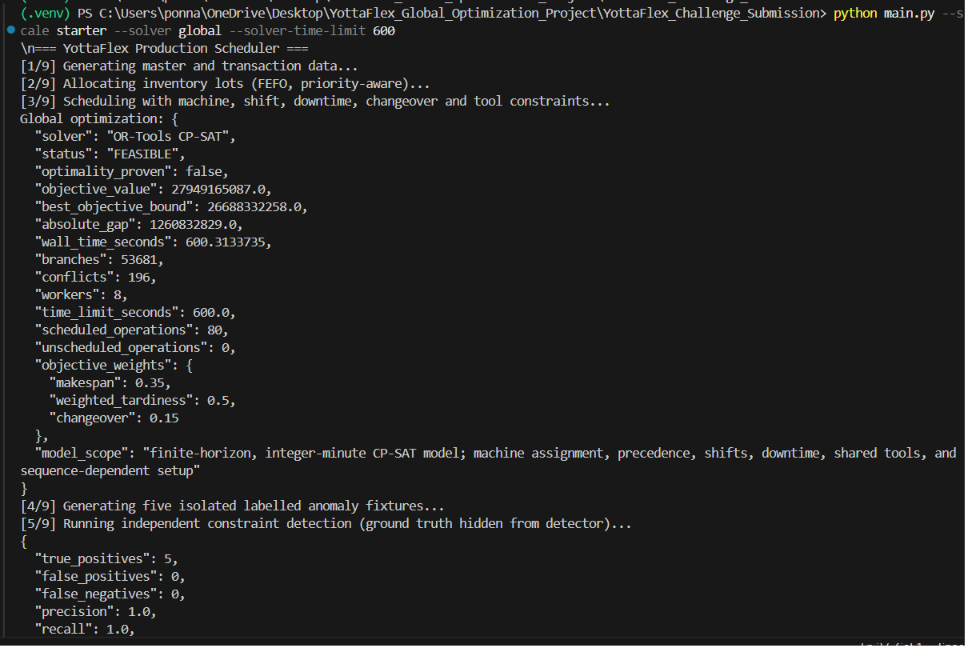

# YottaFlex | Production Scheduling Optimizer

A reproducible, Python-based manufacturing production scheduling system developed for the Associate AI Forward Deployed Engineer challenge.

YottaFlex generates synthetic factory data, allocates materials, builds finite-resource production schedules, detects constraint violations, and presents results through an interactive Streamlit dashboard.

> **Important:** The project includes a fast heuristic scheduler and an OR-Tools CP-SAT optimization model. A `FEASIBLE` result represents a valid schedule but does not prove global optimality. Only `OPTIMAL` with `optimality_proven: true` establishes optimality for the encoded finite-horizon, integer-minute model.

---

## Key Features

- Synthetic manufacturing data generation with starter and full-scale configurations.
- Production routing and operation precedence.
- Machine eligibility, shift calendars, and planned downtime.
- Finite machine capacity and sequence-dependent changeover scheduling.
- Priority-aware FEFO (First-Expiry-First-Out) inventory allocation.
- Shared-tool capacity constraints.
- Multi-objective optimization balancing makespan, weighted tardiness, and changeover costs.
- Independent detection of five types of scheduling anomalies.
- CSV and JSON exports.
- SQLite database and schedule event tracking.
- Interactive Streamlit dashboard.
- Automated validation and reproducibility checks.

## Technology Stack

| Category | Technologies |
|---|---|
| Programming Language | Python |
| Optimization | Google OR-Tools CP-SAT |
| Data Processing | Pandas |
| Dashboard | Streamlit |
| Visualization | Plotly |
| Database | SQLite |
| Data Formats | CSV, JSON |
| Testing | Pytest |

---

## Dataset Overview

YottaFlex generates synthetic manufacturing datasets locally.

| Dataset | Products / SKUs | Machines | Orders | Operations | Materials |
|---|---:|---:|---:|---:|---:|
| Starter | 10 | 8 | 20 | 80 | 30 |
| Full | 100 | 40 | 500 | 2,000 | 200 |

The generated datasets include:

- Production orders and products.
- Production routings and operations.
- Machine resources and eligibility.
- Machine shift calendars and downtime.
- Sequence-dependent changeover matrices.
- Material inventory lots.
- Tool master data and tool requirements.

---

## Project Screenshots

### 1. Full-Scale Production Scheduling Dashboard

Displays 500 production orders, 2,000 scheduled operations, makespan, on-time delivery, and multi-objective scheduling metrics.



### 2. Full-Scale Machine Scheduling Gantt Chart

Visualizes machine-wise production scheduling and operation distribution across the planning timeline.



### 3. Operation Schedule and Production Orders

Displays operation assignments, machine IDs, start and end times, durations, changeovers, and production order details.



### 4. Independent Constraint Detection and Inventory Ledger

Demonstrates anomaly detection, detection metrics, material allocations, and inventory consumption.



### 5. Tool Master and Requirements

Shows available tools, tool capacity, lifecycle status, and production operation tool requirements.



### 6. Baseline Validation and Ground-Truth Scenarios

Displays validation findings and five labelled anomaly scenarios used to evaluate the independent detector.



### 7. CP-SAT Optimization Results

Displays solver execution, objective value, best objective bound, optimality gap, and runtime.



---

## Scheduling Approaches

YottaFlex provides two scheduling approaches.

### 1. Heuristic Scheduler

The default scheduler uses a deterministic four-stage finite-resource list-scheduling heuristic.

It considers:

- Machine eligibility.
- Operation precedence.
- Machine shifts and downtime.
- Shared-tool capacity.
- Sequence-dependent changeover costs.
- Estimated completion time.

The heuristic generates schedules quickly but is not guaranteed to find a globally optimal solution.

### 2. Global Optimization Using OR-Tools CP-SAT

The global optimizer is implemented in:

`src/global_optimizer.py`

It models operation-to-machine assignment and integer-minute start times.

The model includes:

- Machine assignment constraints.
- Operation precedence constraints.
- Machine non-overlap constraints.
- Shift and downtime constraints.
- Shared-tool cumulative capacity.
- Sequence-dependent changeover separation.
- Finite scheduling horizon.

The objective combines makespan, priority-weighted tardiness, and changeover costs using the configurable weights in:

`config/scheduling_objective.json`

### Understanding Solver Status

The solver writes its results to:

`data/optimization_report.json`

| Solver Status | Meaning |
|---|---|
| OPTIMAL | Global optimum proven for the encoded model. |
| FEASIBLE | Valid schedule found, but optimality not proven. |
| INFEASIBLE | No valid schedule exists within the modeled horizon and constraints. |

A `FEASIBLE` solution is not a failed solution. It means CP-SAT found a valid schedule but could not prove that no better solution exists before termination.

The model uses integer-minute time and a finite scheduling horizon. Therefore, an optimality proof applies to the encoded discretized model, not every possible continuous-time industrial scheduling scenario.

A longer solver time limit does not guarantee an optimality proof.

---

## Multi-Objective Optimization

The optimization objective balances three components:

1. Makespan minimization.
2. Priority-weighted tardiness minimization.
3. Sequence-dependent changeover cost minimization.

Default objective weights:

| Objective | Weight |
|---|---:|
| Makespan | 0.35 |
| Weighted Tardiness | 0.50 |
| Changeover | 0.15 |

Configure the weights in:

`config/scheduling_objective.json`

The metrics output reports individual objective components and the composite objective score.

Changing objective weights can improve one KPI while worsening another. Therefore, all objective components should be compared when evaluating optimization performance.

---

## Installation and Setup

### Requirements

- Python 3.10 or later.
- Git.
- Visual Studio Code (recommended).
- Windows PowerShell or another compatible terminal.

### Step 1: Clone the Repository

```powershell
git clone https://github.com/Ponnarasiseelvaraj/YottaFlex-Production-Scheduling-Optimizer.git

cd YottaFlex-Production-Scheduling-Optimizer
```

### Step 2: Create a Virtual Environment

```powershell
py -m venv .venv
```

### Step 3: Activate the Environment

```powershell
.venv\Scripts\Activate.ps1
```

If PowerShell blocks activation:

```powershell
Set-ExecutionPolicy -Scope Process -ExecutionPolicy Bypass

.venv\Scripts\Activate.ps1
```

### Step 4: Install Dependencies

```powershell
python -m pip install --upgrade pip

pip install -r requirements.txt
```

---

## Running the Project

### 1. Run Starter Dataset Using Heuristic Scheduler

```powershell
python main.py --scale starter
```

Starter dataset:

- 20 production orders.
- 80 operations.
- 8 machines.
- 10 products.
- 30 materials.

### 2. Run Full Dataset Using Heuristic Scheduler

```powershell
python main.py --scale full
```

Full dataset:

- 500 production orders.
- 2,000 operations.
- 40 machines.
- 100 products.
- 200 materials.

### 3. Run Global Optimization on Starter Dataset

```powershell
python main.py --scale starter --solver global --solver-time-limit 600
```

### 4. Run Global Optimization on Full Dataset

```powershell
python main.py --scale full --solver global --solver-time-limit 1800
```

The time limit is specified in seconds.

The full-scale CP-SAT model may require substantial computation and may return `FEASIBLE` instead of `OPTIMAL`.

Check `data/optimization_report.json` for:

- Solver status.
- Objective value.
- Best objective bound.
- Absolute and relative optimality gap.
- Runtime.
- Branches and conflicts.

### 5. Launch the Streamlit Dashboard

After generating the datasets and scheduling results:

```powershell
streamlit run dashboard/app.py
```

Open the local URL printed in your terminal.

Usually:

`http://localhost:8501`

### 6. Run Automated Tests

```powershell
pytest -q
```

---

## Independent Constraint Detection

The system implements five independent anomaly detection rules.

| Detection Rule | Description |
|---|---|
| OVERLAP_ON_MACHINE | Detects overlapping operations on the same machine. |
| PRECEDENCE_VIOLATION | Detects operations starting before predecessor completion. |
| MATERIAL_BEFORE_AVAILABLE | Detects material consumption before inventory availability. |
| OUTSIDE_SHIFT | Detects operations scheduled outside machine shift hours. |
| CHANGEOVER_OMITTED | Detects insufficient sequence-dependent setup time. |

The detector evaluates operational data independently of ground-truth labels.

Ground truth is joined only after predictions are generated, for evaluation.

The project includes five isolated labelled anomaly scenarios to evaluate detection precision, recall, and F1 score.

These controlled test results should not be interpreted as guaranteed performance on all real-world manufacturing datasets.

---

## Generated Outputs

The `data/` directory contains generated datasets and execution outputs.

Important outputs include:

- Master and transaction tables in CSV and JSON.
- Operation schedules.
- Schedule event history.
- Anomaly scenarios and ground-truth labels.
- Constraint detection results and metrics.
- Material allocations.
- Inventory balances and shortages.
- Scheduling metrics.
- Applied objective configuration.
- Validation summaries.
- Source manifests.
- SQLite production database.
- CP-SAT optimization report.

The global optimizer generates:

`data/optimization_report.json`

Generated outputs can be recreated by running the CLI.

---

## Reproducibility

- Default random seed: `20261022`.
- The CLI generates independent copies and compares SHA-256 checksums for source CSV tables.
- The additional reproducibility run can be skipped using `--skip-repro` where supported by the selected command.
- All datasets are synthetic and generated locally.
- No external or personal dataset is used.

---

## Validation

The project includes validation checks for:

- Scheduling keys and data joins.
- Operation precedence.
- Machine calendars.
- Inventory arithmetic.
- Shared-tool capacity.
- Changeover requirements.

The validation process helps identify inconsistencies in generated schedules and resource allocations.

---

## Limitations

- The heuristic scheduler does not guarantee global optimality.
- CP-SAT optimality is relative to the finite horizon and integer-minute model.
- A `FEASIBLE` result does not prove global optimality.
- Large-scale optimization may require substantial computational resources.
- Synthetic anomaly scenarios are controlled test cases, not a replacement for real-world validation.
- Production deployment would require transactional inventory posting, schedule versioning, monitoring, and integration with actual manufacturing systems.

---

## Future Improvements

- Further strengthen CP-SAT search performance and optimality bounds.
- Improve optimization performance for larger manufacturing datasets.
- Benchmark objective gaps across different dataset sizes.
- Add advanced schedule comparison and scenario analysis.
- Extend constraint validation for additional manufacturing requirements.

---

## Repository Structure

```text
YottaFlex-Production-Scheduling-Optimizer/
│
├── config/              # Solver and objective configurations
├── dashboard/           # Streamlit dashboard
├── data/                # Generated datasets and outputs
├── docs/                # Architecture and developer documentation
├── repro_check/         # Reproducibility artifacts
├── screenshots/         # Project screenshots
├── src/                 # Core scheduling and optimization modules
├── tests/               # Automated tests
│
├── main.py              # Main execution entry point
├── requirements.txt     # Python dependencies
├── .gitignore
└── README.md
```

---

## Author

**Ponnarasi Selvaraj**

GitHub: [Ponnarasiselvaraj](https://github.com/Ponnarasiseelvaraj)

Project Repository:

[ YottaFlex - Production Scheduling Optimizer ](https://github.com/Ponnarasiseelvaraj/YottaFlex-Production-Scheduling-Optimizer)

---

**YottaFlex | Production Scheduling Optimizer**

*Constraint-aware scheduling. Multi-objective optimization. Reproducible manufacturing analytics.*
